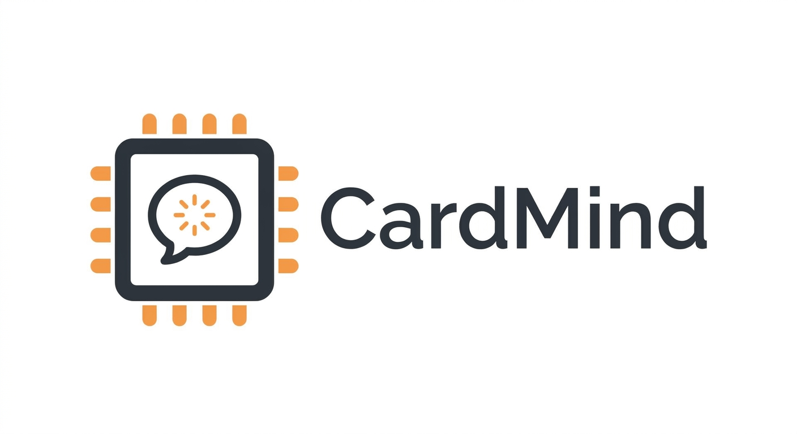
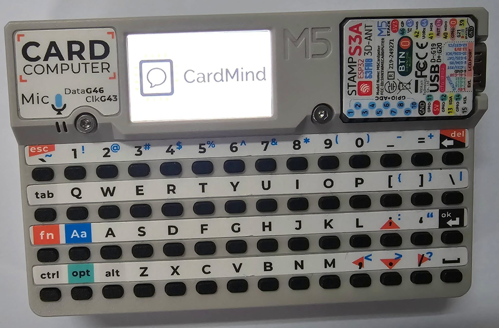
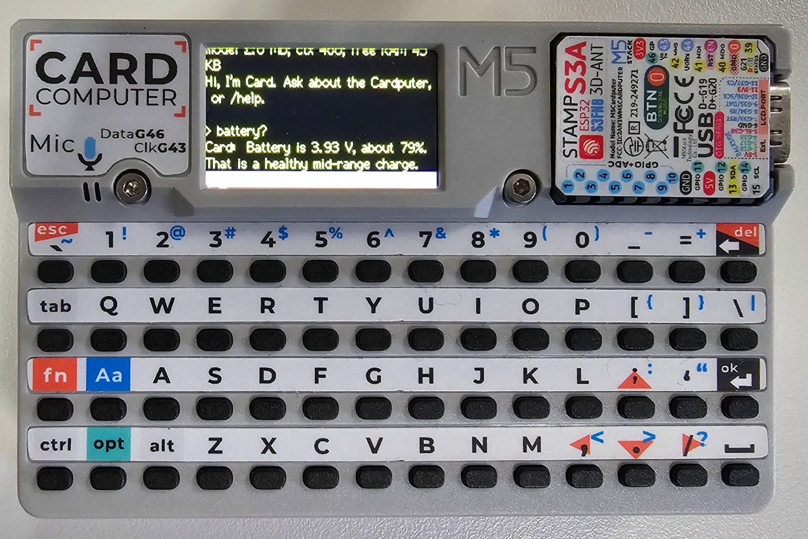
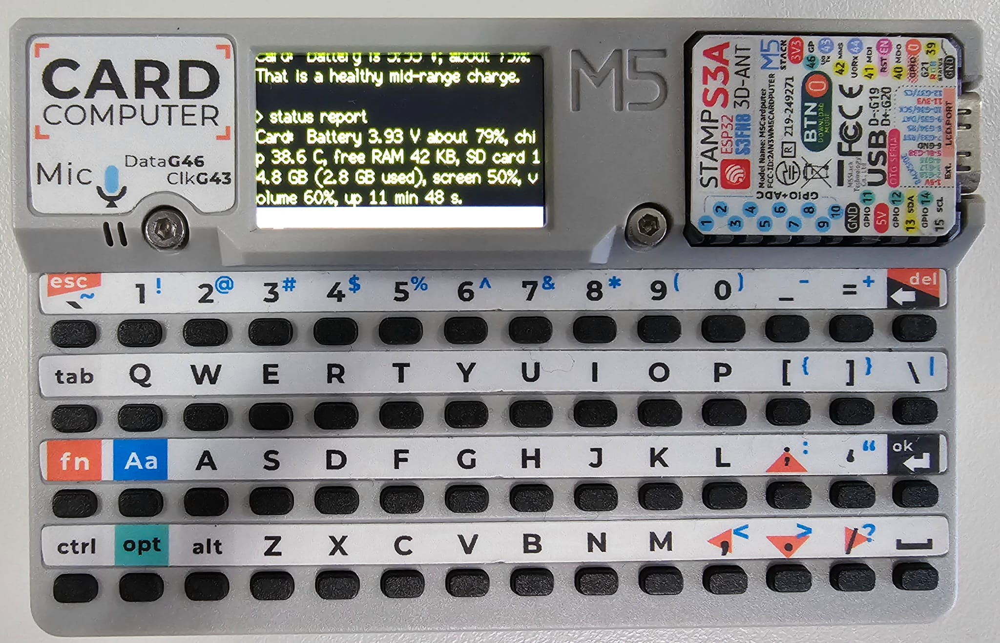
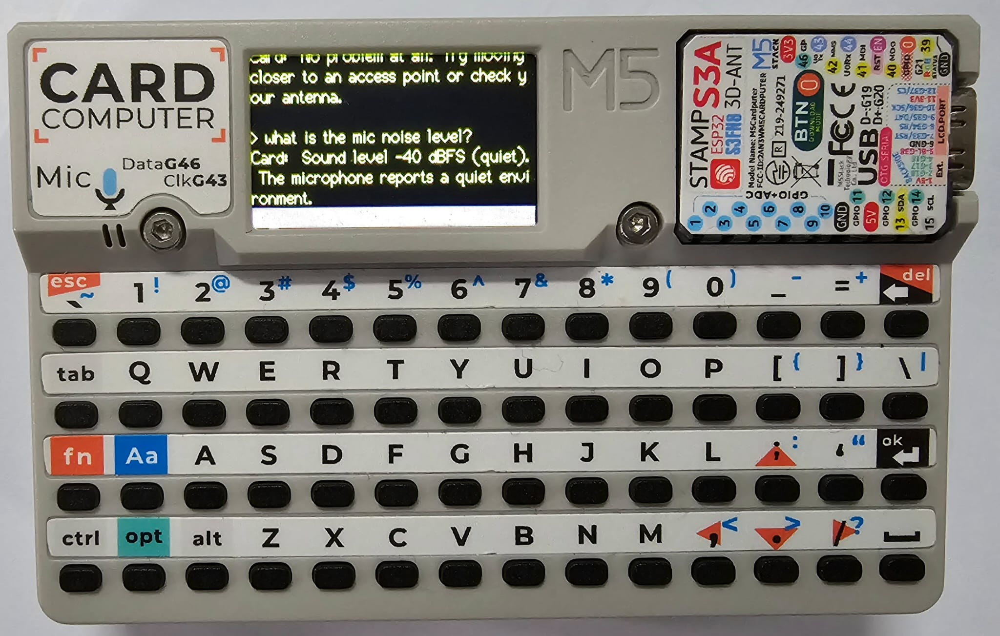
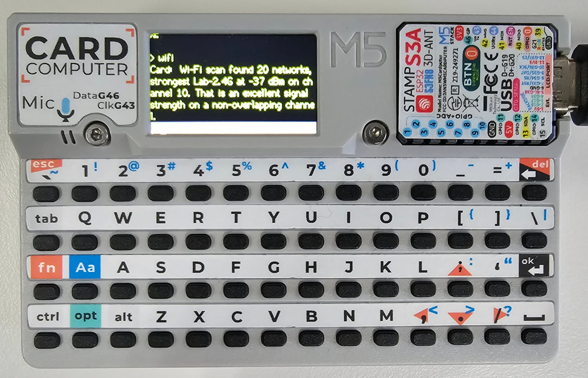
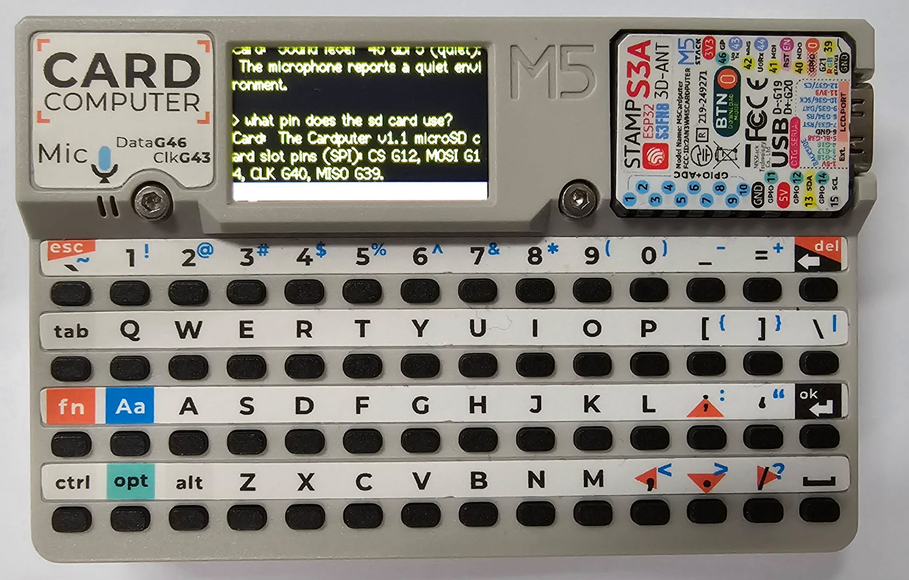
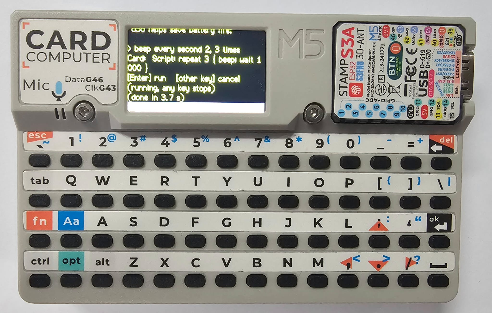
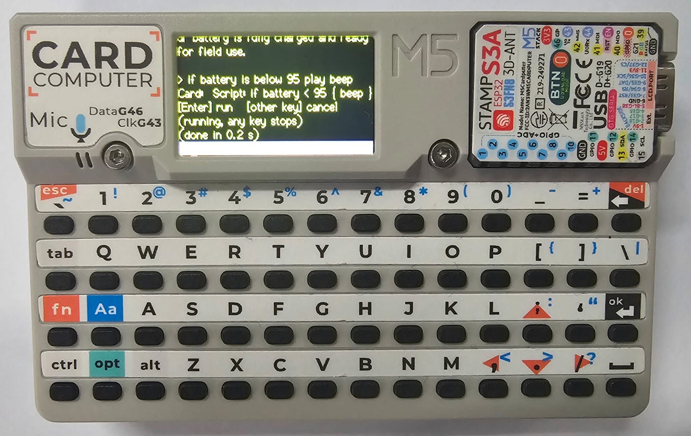

<p align="center"></p>

<p align="center"><b>An offline assistant on the M5Stack Cardputer: a 2.7M-parameter language model with tools, running on an ESP32-S3</b></p>

---

CardMind runs a **tiny transformer language model on a microcontroller**, fully offline. Its assistant,
**Card**, lives on an M5Stack Cardputer v1.1 (ESP32-S3, 8 MB flash, **no PSRAM**). Card can:

- **report live readings:** battery, chip temperature, RAM, SD card, noise level, Wi-Fi, Grove I2C
- **control the hardware:** RGB LED, screen brightness, volume, beeps, infrared codes
- **write small scripts** ("blink the led red 5 times") that run only after you press Enter
- **answer questions about the hardware** from 59 hand-written knowledge cards (pins, power, setup)

Nothing leaves the device: no cloud, no internet, no phone app.

```
you>  battery?
Card: Battery is at 3.92 V, about 78%. That is plenty for a few more hours of use.

you>  blink the led red 5 times
Card: Script: repeat 5 { led red; wait 300; led off; wait 300 }
      [Enter] run   [other key] cancel
```

> The project was called **espLLM** until 2026-11. The SD-card folder `/espllm/` and the `ESPLLM_*`
> environment variables keep the old name.

## Contents

- [Screenshots](#screenshots)
- [How it works](#how-it-works)
- [What kind of model this is](#what-kind-of-model-this-is)
- [Quick start](#quick-start)
- [Using Card](#using-card)
- [Card scripts](#card-scripts)
- [Device commands](#device-commands)
- [Building from source](#building-from-source)
- [Testing on a PC](#testing-on-a-pc)
- [Accuracy](#accuracy)
- [Limits](#limits)
- [Repository layout](#repository-layout)
- [Training data](#training-data)
- [Documentation](#documentation)
- [License](#license)

## Screenshots

All photos are of a real Cardputer v1.1 running model d13.

<p align="center"><br><sub>The boot screen</sub></p>

<table>
<tr><td width="50%">battery?</code>: a live reading with a short comment"><br><sub><code>battery?</code>: a live reading with a short comment</sub></td><td width="50%">status report</code>: battery, chip, RAM, SD card, screen, volume, uptime"><br><sub><code>status report</code>: battery, chip, RAM, SD card, screen, volume, uptime</sub></td></tr>
<tr><td width="50%">what is the mic noise level?</code>: the microphone, measured"><br><sub><code>what is the mic noise level?</code>: the microphone, measured</sub></td><td width="50%">wifi</code>: a Wi-Fi scan with the strongest network"><br><sub><code>wifi</code>: a Wi-Fi scan with the strongest network</sub></td></tr>
<tr><td width="50%">what pin does the sd card use?</code>: an answer from a knowledge card"><br><sub><code>what pin does the sd card use?</code>: an answer from a knowledge card</sub></td><td width="50%">beep every second 2, 3 times</code>: a script, run after Enter"><br><sub><code>beep every second 2, 3 times</code>: a script, run after Enter</sub></td></tr>
<tr><td width="50%">if battery is below 95 play beep</code>: a script with a condition"><br><sub><code>if battery is below 95 play beep</code>: a script with a condition</sub></td><td></td></tr>
</table>

## How it works

The model never measures or calculates anything itself. Plain C code works out what you asked for and gets
the facts first. The model then turns those facts into a short reply:

```
"battery?" ─► request matcher (device.c) ─► hw.cpp reads the ADC ─► "Device: battery 3.92 V, about 78%."
           ├► calculator (calc.c)                                ─► "Calculator: 3/4 of 20 = 15."
           ├► script request? ("times", "every", "if" ...)       ─► "Mode: script. 3 s = 3000 ms."
           └► BM25 search over kb.bin (only if no Device line)   ─► a knowledge card
                                                  │
                      <ctx> facts <usr> question <bot> ─► 2.7M model ─► reply (screen + robot voice)
```

Gemini writes the training conversations. A Python pipeline trains the model and exports it to a 2.8 MB
int8 file, and portable C firmware runs it. Every rule the device applies (tokenizer, request matcher,
calculator, search, script interpreter, forward pass) also exists in Python, and a test checks that the
two give identical results. See [docs/DESIGN.md](docs/DESIGN.md) for the full design.

## What kind of model this is

It is not an LLM, and it is small even next to small language models (SLMs). It sits at TinyML scale:

| | Typical size | Examples |
|---|---|---|
| Large language model (LLM) | tens of billions of parameters and up | GPT-4-class models, Claude, Llama 70B |
| Small language model (SLM) | about 100 million to 10 billion | Phi-3 (3.8B), Gemma 2B, SmolLM (135M) |
| Tiny language model (TinyML) | about 1 to 50 million | TinyStories research models, **CardMind: 2.7 million** |

- **Same design as an LLM.** It is a decoder-only transformer with 6 layers, width 192, and 6 heads sharing
  1 key/value head (multi-query attention). It uses RoPE, SwiGLU, a 2,048-token vocabulary and up to 512
  tokens of context.
- **Tiny footprint.** The int8 weights take 2.8 MB and are read straight from flash. The int8 KV cache
  lives in the 512 KB of on-chip RAM. There is no PSRAM and no accelerator.
- **Tools do the knowing.** At this size a model cannot do arithmetic or remember facts reliably, so tools
  supply them and the model handles the language.
- **Narrow on purpose.** It was trained on about 15,000 conversations about this one device. It is not a
  general chatbot.

## Quick start

### What you need

- An **M5Stack Cardputer v1.1** (ESP32-S3FN8)
- A **microSD card** (any size, FAT32)
- [PlatformIO](https://platformio.org/) (VS Code extension or `pip install platformio`)
- The model files `model.bin` and `kb.bin`, from the [latest release](https://github.com/thelee81/CardMind/releases/latest), or [build them yourself](#building-from-source)

### 1. Flash the firmware

```bash
git clone https://github.com/thelee81/CardMind.git
cd CardMind/firmware
pio run -t upload --upload-port COM3        # Linux: /dev/ttyACM0, macOS: /dev/cu.usbmodem*
```

<details>
<summary>Upload fails with "No serial data received"?</summary>

Build first, then write only the app at a lower speed:

```bash
pio run
python ~/.platformio/packages/tool-esptoolpy/esptool.py --chip esp32s3 --port COM3 --baud 115200 \
    write_flash 0x10000 .pio/build/cardputer/firmware.bin
```

If the port does not appear, hold **G0** while plugging in USB to enter download mode.
</details>

### 2. Copy the model to the SD card

```
SD card root
└── espllm/
    ├── model.bin      the model (copied into flash at boot when it changes, about 10 s)
    └── kb.bin         the knowledge cards (searched in place)
```

### 3. Boot

The CardMind logo appears, then the console. Type `/help`, or just ask: `battery?`

> An older `model.bin` on the SD card overwrites the flash copy at boot, so always put a new model on the
> card.

## Using Card

Type a question or a command and press Enter. Card answers on screen and reads the reply aloud.

### Live readings

| Try | Card reports |
|---|---|
| `battery?` · `how much charge is left` | battery voltage and estimated percentage (ADC on G10) |
| `how hot is the chip` | ESP32-S3 internal temperature (the chip, not the room) |
| `free ram` · `memory check` | free heap, largest block, flash, model size, context length |
| `sd card?` · `how full is the sd card` | card type, size and space used |
| `how noisy is it here` · `mic level` | sound level in dBFS, labelled quiet, moderate or loud |
| `scan wifi` · `how strong is the signal` | network count, strongest SSID, RSSI and channel |
| `scan the grove port` · `i2c scan` | I2C addresses on G2/G1, with likely M5Stack Unit names |
| `uptime?` | time since boot |
| `what chip is this` · `mac address?` | chip revision, cores, MHz, MAC, ESP-IDF version |
| `status report` | battery, temperature, RAM, SD, brightness, volume and uptime on one line |

### Actions (done immediately)

| Try | What happens |
|---|---|
| `led red` · `turn the rgb light blue` · `led off` | RGB LED (WS2812 on G21). The LED shares power with the backlight, so Card raises the brightness first if needed |
| `dim the screen` · `set brightness to 40` · `screen max` | backlight 10 to 100% |
| `volume 30` · `louder` · `mute` | speaker volume 0 to 100% |
| `beep` · `test the speaker` | a 2000 Hz beep for 200 ms |
| `send ir address 4 command 8` · `send ir address 0x20 command 0x10` | NEC infrared code on G44 |

Questions never trigger actions. `how do i turn the led red in arduino` and `is the led on` change
nothing; how-to questions get a knowledge card instead.

### Questions about the hardware

```
what pins does the sd card use
how do i enter download mode
which pin is the led on
how big is the battery
does it have gps
how do i program it in arduino
what grove units can i connect
```

The answers come from 59 hand-written cards based on the Cardputer v1.1 manual
(`pipeline/lib/device_cards.py`). Text files you put in `data/sources/notes/` are added to the knowledge
base when you rebuild it.

## Card scripts

Requests that repeat, wait, or depend on a condition become a **one-line script**. Typical model output: Card shows the script
first. **Enter** runs it, any other key cancels it, and any key stops a script that is running.

```
blink the led red 5 times              → repeat 5 { led red; wait 300; led off; wait 300 }
beep every 2 seconds, 4 times          → repeat 4 { beep; wait 2000 }
beep after 2 minutes                   → repeat 2 { wait 60000 }; beep
turn the led red then green then blue, 1 second each
                                       → led red; wait 1000; led green; wait 1000; led blue; wait 1000
fade the screen from 100 to 20 percent → bright 100; wait 300; bright 60; wait 300; bright 20
beep at 1000 hz for half a second      → beep 1000 500
if the battery is below 20 percent beep
                                       → if battery < 20 { beep }
show the battery every 10 seconds, 5 times
                                       → repeat 5 { show battery; wait 10000 }
every 10 seconds for a minute, if the room is loud turn the led red, else off
                                       → repeat 6 { if mic > -30 { led red } else { led off }; wait 10000 }
```

### The language

| Statement | Meaning |
|---|---|
| `led COLOR` | `off red green blue white yellow orange purple pink cyan magenta` |
| `bright N` · `vol N` | screen brightness 10 to 100 · speaker volume 0 to 100 |
| `beep` · `beep HZ` · `beep HZ MS` | default 2000 Hz for 200 ms; HZ 100 to 8000, MS 10 to 2000 |
| `ir ADDR CMD` | NEC infrared code, 0 to 255 each |
| `wait MS` | pause of 1 to 60000 ms |
| `show READING` | print a reading: `battery` (%), `temp` (°C), `mic` (dBFS), `ram` (KB), `uptime` (s), `bright`, `vol` |
| `repeat N { ... }` | N from 1 to 100 |
| `if READING OP N { ... } else { ... }` | OP is `<` `>` `<=` `>=` `==` `!=`; `else` is optional |

Statements are separated by `;`. A script is limited to 200 characters, a nesting depth of 4, 2,000 steps
and 10 minutes in total. Anything else is rejected with a clear message, for example `repeat: 1 to 100`.

### Write your own

```
/do repeat 3 { led cyan; beep 1500 100; wait 400; led off; wait 400 }
/do if mic > -40 { led red } else { led green }
/do repeat 5 { show temp; wait 2000 }
/save alarm           saves the last script as /espllm/scripts/alarm.txt
/scripts              lists the saved scripts
/run alarm            runs a saved script
```

`/do` runs exactly what you type, with no model involved. Use it when a script has to be exact.

## Device commands

| Command | |
|---|---|
| `/help` | examples of what to ask |
| `/new` | start a new chat (clears the model's memory of the conversation) |
| `/ctx` | show what the model was given on the last turn (Device line, hints, card); useful for checking a reply |
| `/do SCRIPT` · `/save NAME` · `/run NAME` · `/scripts` | Card scripts (above) |
| `/mute` · `/talk` | robot voice off or on |
| `/vol 0-255` · `/speed 40-120` | voice volume and speed (lower is faster) |

If a reply looks wrong, type `/ctx` straight away. If the `Device:` line there is right, the model
mis-copied it; if it is wrong, the firmware read it wrongly.

## Building from source

### Setup

```bash
python -m pip install -r requirements.txt      # with an NVIDIA GPU, install the CUDA build of torch first
cp .env.example .env                          # add GEMINI_API_KEY (only needed to generate new data)
export PYTHONIOENCODING=utf-8                 # Windows: keeps Unicode output working
```

All settings (model shape, training, data volume, spending cap) live in `config.py`.

### The pipeline

```bash
# 3. Generate training conversations with Gemini (costs money: dry run first, --yes to spend)
python pipeline/03_generate_device.py submit               # prints the estimated cost only
python pipeline/03_generate_device.py submit --limit 40 --yes   # small pilot
python pipeline/03_generate_device.py submit --yes         # full round 1
python pipeline/03_generate_device.py collect
python pipeline/03_generate_device.py submit --round 3 --yes && \
python pipeline/03_generate_device.py collect --round 3     # Card scripts (rounds 2 to 4 add targeted data)

# 4 to 9. Build the dataset, train and export (free; about 10 minutes on an RTX A4000)
python pipeline/04_build_device_dataset.py   # replays every message through the device rules, filters bad replies
python pipeline/05_train_tokenizer.py        # 2,048-token SentencePiece tokenizer
python pipeline/06_pretokenize.py
python pipeline/07_train.py
python pipeline/08_export.py                 # -> data/sd_card/espllm/model.bin (int8)
python pipeline/09_build_kb.py               # -> data/sd_card/espllm/kb.bin
```

`BUDGET_USD` in `config.py` is a hard cap on API spending. Building all the data for the current model
cost about $22.

### Plumbing test without any API key

```bash
export ESPLLM_DATA=data_demo ESPLLM_DEMO=1
python pipeline/00_demo_data.py && python pipeline/01_ingest_sources.py && \
python pipeline/04_build_dataset.py && python pipeline/05_train_tokenizer.py && \
python pipeline/06_pretokenize.py && python pipeline/07_train.py && python pipeline/08_export.py
```

This produces a gibberish model, but it exercises every step.

## Testing on a PC

`firmware/host/` builds the device's C code for your PC (gcc), so you can test without the hardware.

```bash
sh firmware/host/build_host.sh               # -> firmware/host/host_chat(.exe)
python pipeline/verify.py                    # C == Python: tokenizer, calculator, matcher, scripts, BM25, logits
```

### Chat with the device code

```bash
./firmware/host/host_chat data/sd_card/espllm/model.bin data/sd_card/espllm/kb.bin
```
```
you> /status bat_mv=3500 bat_pct=20 sd_used_mb=2      (set simulated readings)
you> battery?
bot> Battery is at 3.50 V, about 20%. You should charge it soon.
  [ctx] Device: battery 3.50 V, about 20%.
```

### Single-purpose tools

```bash
./firmware/host/host_chat --dev "turn the led blue"           # what the request matcher decides
./firmware/host/host_chat --script "repeat 3 { beep; wait 500 }"   # parse and dry-run a script
./firmware/host/host_chat --hints "beep after 2 minutes"      # number hints for script mode
./firmware/host/host_chat --calc "what is 3/4 of 20"
./firmware/host/host_chat --say "3/4 of 20 = 15"              # what the robot voice would say
python pipeline/chat.py --show-ctx                            # the same chat, in Python
```

### Accuracy tests

```bash
python pipeline/eval_device.py  data/sd_card/espllm/model.bin   # 144 requests with random readings
python pipeline/eval_scripts.py data/sd_card/espllm/model.bin   # 26 script requests plus 4 over the limits
python pipeline/eval_sd.py      data/sd_card/espllm/model.bin   # SD sizes, including tiny amounts used
python pipeline/eval_scripts.py data/d9/model.bin,data/d9/kb.bin data/d13/model.bin   # compare models
```

## Accuracy

Model d13, measured through the PC build of the device code:

| Test | Result |
|---|---|
| Live reading or action result stated correctly | 142 of 144 |
| Replies that add a number not in the reading | 15 of 144 (mostly in the extra explanatory sentence) |
| SD card sizes copied correctly | 30 of 30 |
| Script requests giving a valid script | 26 of 26 |
| Scripts exactly right | 23 of 26 |

All readings, actions and script commands have also been checked by hand on a real Cardputer. The
model's history (d1 to d13) is in [docs/RUNBOOK.md](docs/RUNBOOK.md).

## Limits

- **Short answers.** Replies are 1 to 3 sentences. The readings are copied from the device, but the
  sentence after a reading (a tip or interpretation) can contain a wrong detail.
- **Narrow.** Chit-chat and open questions are its weakest area. `/help` shows what Card is good at.
- **One request per message.** "battery and temperature" gives the status report.
- **Scripts need checking.** Hex IR codes can come out with address and command swapped. Requests over
  the limits ("forever", "500 times") get a shortened script instead of a refusal. Read the script before
  pressing Enter.
- **A Wi-Fi scan restarts the chat.** The scan needs about 64 KB of RAM, so the model's memory is freed
  during it. Card never connects to a network.
- **The mic and the speaker share G43,** so speech stops during a noise reading.
- **No real code.** There is no compiler on the ESP32-S3, and MicroPython would not fit beside the model,
  hence Card scripts.
- **Double-check pin numbers** before wiring anything; facts come from the cards, but the model can
  mis-phrase them.

## Repository layout

```
CardMind/
├── README.md                 this file
├── config.py                 all settings: model shape, training, data volume, budget, sampling
├── requirements.txt
├── .env.example              API key template (copy to .env)
├── assets/logo/              logo files
├── assets/screenshots/       photos of Card running on the device
├── docs/
│   ├── DESIGN.md             architecture and design decisions
│   └── RUNBOOK.md            procedures (build, train, flash, debug) and model history
├── pipeline/                 Python: data → model → device files
│   ├── 03_generate_device.py     training data from Gemini (rounds 1 to 4)
│   ├── 04_build_device_dataset.py  replays data through the device rules and filters it
│   ├── 05 … 09_*.py              tokenizer, pretokenize, train, export, knowledge base
│   ├── 00 … 04 (others)          generic and demo path (notes → curriculum → conversations)
│   ├── verify.py                 C vs Python checks
│   ├── eval_device.py · eval_scripts.py · eval_sd.py
│   ├── chat.py                   chat in Python
│   ├── lib/                      Python twins of the C code and shared helpers
│   │   ├── devtext.py            request matcher, Device line, script hints   (↔ device.c)
│   │   ├── scripttext.py         Card script parser and interpreter           (↔ script.c)
│   │   ├── kbtext.py             text rules, calculator, BM25                 (↔ calc.c, kb.c)
│   │   ├── npref.py              NumPy forward pass                           (↔ engine.c)
│   │   ├── model.py              PyTorch model for training
│   │   ├── device_cards.py       the 59 knowledge cards
│   │   └── gemini.py · batch.py  API clients with a spending cap
│   └── tools/make_logo.py        logo → firmware/src/logo.h
├── firmware/                 PlatformIO project (Arduino on ESP-IDF)
│   ├── platformio.ini · partitions.csv
│   ├── src/
│   │   ├── engine.c · tokenizer.c · chat.c · kb.c      model, prompts, search   (portable C)
│   │   ├── device.c · calc.c · script.c · tts_text.c   rules and tools         (portable C)
│   │   ├── main.cpp      UI, SD card, boot, commands
│   │   ├── hw.cpp        sensors and actions
│   │   └── tts.cpp       SAM robot voice on core 0
│   └── host/                 PC build of the portable C code (host_chat)
└── data/                     mostly git-ignored (checkpoints, models, token files)
    ├── generated/device*.jsonl   raw training conversations from Gemini (rounds 1 to 4)
    ├── dataset/train.jsonl · val.jsonl   the built dataset the current model (d13) was trained on
    └── sources/notes/        your own notes for the knowledge base
```

## Training data

The training data is included, so the model can be rebuilt **without any API key or spending**:

| File | Contents |
|---|---|
| `data/generated/device.jsonl` | round 1: device, knowledge-card and persona conversations, with simulated readings |
| `data/generated/device_r2.jsonl` | round 2: extra data for d1's weak spots |
| `data/generated/device_r3.jsonl` | round 3: Card scripts |
| `data/generated/device_r4.jsonl` | round 4: harder scripts (hex IR, minutes, sequences, fades) |
| `data/dataset/train.jsonl`, `val.jsonl` | the dataset built by step 4: 15,304 conversations with the exact `<ctx>` the firmware builds (script conversations appear twice in `train.jsonl`) |

Each line of a `data/generated/` file is one conversation: its kind, the simulated device status, the
planned requests and the turns. Each line of `data/dataset/` is `{"kind", "turns": [{"ctx", "user", "bot"}]}`.

To retrain from the included data, skip step 3:

```bash
python pipeline/04_build_device_dataset.py && python pipeline/05_train_tokenizer.py && python pipeline/06_pretokenize.py && python pipeline/07_train.py && python pipeline/08_export.py && python pipeline/09_build_kb.py
```

The conversations were written by Google Gemini (gemini-3.5-flash-lite) from prompts in
`pipeline/03_generate_device.py`, and filtered by step 4. They are synthetic: the readings are simulated,
and no personal data is involved.

## Documentation

- [docs/DESIGN.md](docs/DESIGN.md): architecture, memory budget, prompt format, data pipeline and
  the reasons behind each choice
- [docs/RUNBOOK.md](docs/RUNBOOK.md): step-by-step procedures, debugging, and the record of every model trained

## License

[MIT](LICENSE), for the code, the knowledge cards and the training data in this repository.

## Notes

- Training data was generated with Google Gemini (and earlier with Anthropic Claude). Check the
  providers' terms for your use.
- The knowledge cards are based on M5Stack's public Cardputer v1.1 documentation. M5Stack and Cardputer
  are trademarks of M5Stack Technology Co., Ltd.; this project is not affiliated with them.
- The robot voice uses SAM (Software Automatic Mouth) via the ESP8266SAM library.
